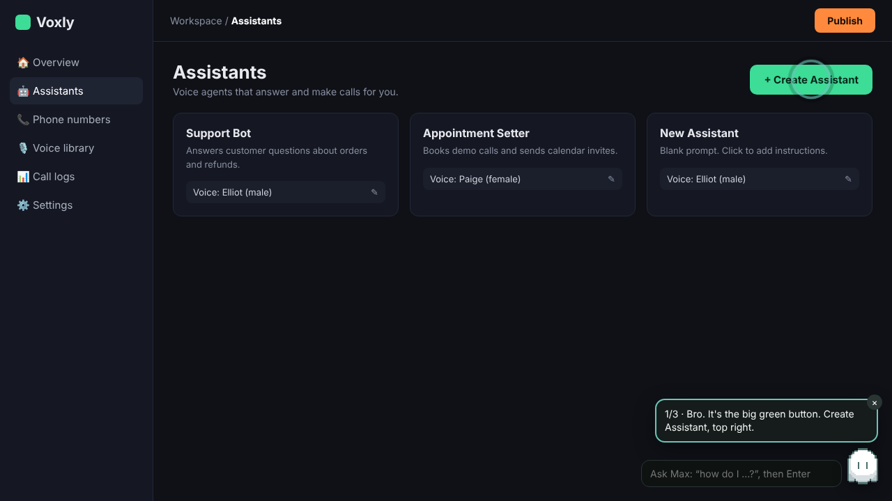
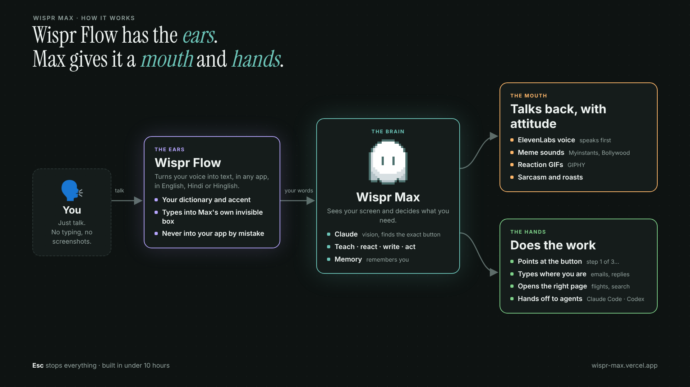

<p align="center"></p>

<h1 align="center">Wispr Max</h1>

<p align="center"><b>Wispr Flow has the ears. I gave it a mouth and hands.</b><br />
A little AI buddy on your desktop that <b>teaches you how to do the work</b>: you talk through Wispr Flow, Max looks at your screen and points at the exact button, step by step, roasting you with memes while it's at it.</p>

<p align="center">
  <a href="https://wispr-max.vercel.app"><b>Try it in your browser (no download)</b></a> ·
  <a href="https://youtu.be/g393F6Cy6_Y">Demo video</a> (<a href="https://youtu.be/g393F6Cy6_Y?t=66">skip to the demo, 1:06</a>) ·
  <a href="https://github.com/Iamritupatil/wispr-max/releases/latest">Desktop app</a> ·
  <a href="https://wispr-max.vercel.app/wispr-max-extension.zip">Chrome extension</a>
</p>

<p align="center"><sub>Built in under 10 hours for the <b>WeMakeDevs × Wispr Flow "No Hands" hackathon</b>.</sub></p>

<p align="center"></p>

---

## The problem

Every time you get stuck in an app (where's the edit button, how do I submit this, how do I set up my first voice agent), you leave your flow:

1. take a screenshot,
2. open ChatGPT and explain the whole page,
3. read a wall of "step 1, step 2, step 3",
4. switch back and hunt for the buttons yourself.

On a free plan you even hit the upload limit. It's slow, it breaks your focus, and the answer is never *on* your screen.

## The fix: Max

Max is a tiny pixel ghost that lives on top of every app.

- **It teaches, it doesn't lecture.** Ask "how do I…?" and Max flies onto the exact button, says the step (*"1/3 · Click Create Assistant, top right"*) and waits for your click. Then it looks again and shows the next one. Change your mind mid-task ("actually, I want to name it first") and it follows you.
- **It talks first.** The conversation isn't one-sided: Max greets you, notices things on your screen and keeps the context until you press **Esc**.
- **It has a personality.** Meme sounds, reaction GIFs, Bollywood clips and sarcasm. Ask an obvious question and you get roasted, then helped. Ask *"Am I the best coder alive?"* and find out.
- **It speaks your language.** Hindi and Hinglish, in Roman letters or Devanagari.
- **It does the work too.** It writes emails and replies right where you're typing, opens the right page for you, remembers things about you (*"remember I'm vegetarian"*), and hands bigger jobs to **Claude Code** or **Codex** on your machine.
- **Esc stops everything.** Voice, memes, the walkthrough.

## How Wispr Flow fits in

<p align="center"></p>

**Wispr Flow is Max's ears, and Max only listens through Flow.**

I first built Max with AssemblyAI for speech-to-text, but it kept mishearing my Indian accent ("hackathon" became "agor"). Wispr Flow understood me, so I rebuilt Max around it:

1. **You talk through Flow**, with your normal Flow key, in any app. Flow does the hearing: your accent, your dictionary, Hindi or English.
2. **Flow's words go to Max, never into your app.** Max gives Flow its own invisible text box, so nothing lands in the chat or document you're in.
3. **Max reads your screen with Claude** and decides what you need: teach, react, write or act.
4. **Max answers with a mouth and hands:** it talks (ElevenLabs), plays a meme sound (Myinstants) and a GIF (GIPHY), points at the button, types, opens pages or starts an agent.

Plain Flow dictation stays plain dictation: Max only steps in when you ask it to.

## Three ways to use it

| | How | Best for |
|---|---|---|
| 🌐 **In your browser** | Open **[wispr-max.vercel.app](https://wispr-max.vercel.app)** → *Open dashboard* → pick a sample app (Voxly, like Vapi, or Mailbox) or share your own tab, then ask with Wispr Flow. Max circles the button with a roast, a GIF and a meme sound. | Trying it in 10 seconds |
| 🧩 **Chrome extension** | Download the [extension](https://wispr-max.vercel.app/wispr-max-extension.zip), **Extract All**, open `chrome://extensions`, turn on **Developer mode**, **Load unpacked** and pick the folder with `manifest.json`. On any site, click the ghost (or **Alt+M**), ask with Wispr Flow, and Max points at the real button on the page. | Any website |
| 🖥️ **Desktop app** | Install from [Releases](https://github.com/Iamritupatil/wispr-max/releases/latest). In any app, **tap Alt twice**, then hold your Wispr Flow key and ask. | Every app, writing in place, agents |

The desktop app updates itself silently (Settings → *Check for updates*). Windows may say "unknown publisher" the first time: click **More info → Run anyway**, because the app isn't code-signed yet.

## Things to try

| Say (through Wispr Flow) | Max |
|---|---|
| "How do I create a new assistant?" | Circles **Create Assistant**, says step 1 of 3, waits for your click |
| "Actually, I want to name it Cara, with a female voice" | Follows the change: rename, then the voice picker |
| "Am I the best coder alive?" | Side-eye dog GIF, a *bruh*, and *"Best coder alive. Sure, bro. Sure."* over a screaming chicken |
| "I got 3 medals in League of Legends" | *faaah*, an anime facepalm, and a deadpan roast |
| "Write a follow-up to Tejas asking about my offer letter" | Writes it in your style, right where you're typing |
| "Find me flights to Goa next Friday" | Opens the search for you and reads it back |
| "Remember I'm vegetarian" | Remembers it for every answer after |
| "Tell Claude to research the founder of Hey Clicky" | Runs Claude Code on your machine and opens the full answer |

## Tech

- **Wispr Flow**: all voice input. The desktop app reads Flow's text from Max's own invisible box (with Flow's local history, read-only, as a fallback); the web app and extension take Flow's dictation in their ask box.
- **Claude** (Anthropic): vision on a screenshot of your screen to find the exact button (pixel coordinates), the step-by-step plan, writing in your style, and Gen Z reactions.
- **Electron + TypeScript** desktop app: a transparent overlay for the ghost, a global keyboard hook for Alt and Esc, silent auto-updates from GitHub Releases.
- **Vercel** functions as the hosted server (`api/`): no API keys needed on your machine.
- **ElevenLabs** (voice), **Myinstants** (meme sounds), **GIPHY** (reaction GIFs).
- **Claude Code / Codex** for agent hand-offs, on your own subscription.

### Project structure

```
src/
  core/            shared logic, unit tested
    ai.ts          Claude: guide (screen walkthroughs), compose, react (Gen Z), with JSON schemas
    intent.ts      what you asked for: teach, react, write, agent; Hindi and swears included
    prompts.ts     the system prompts, Max's personality and the guide rules
    sound.ts       meme sounds (Myinstants) and Max's built-in Bollywood clips
    gif.ts         reaction GIFs (GIPHY)
    flow-schema.ts reading Wispr Flow's local history
  main/            Electron main process
    main.ts        sessions, the walkthrough loop, conversation memory, Esc
    talk-key.ts    the keyboard hook: Alt, Esc, the next click
    agent.ts       hand-offs to Claude Code / Codex
    updater.ts     silent updates
  renderer/        the ghost overlay, the invisible box Flow types into, the dashboard
api/               hosted server: write, voice, gif, sound, download, health
web/               the website: landing page, dashboard demos, sample apps
extension/         the Chrome extension (Manifest V3)
test/              node:test suites
```

## Run it yourself

Requirements: Node 22+ and [Wispr Flow](https://wisprflow.ai). No keys needed: Max uses the hosted server unless you add your own Anthropic key in Settings.

```bash
npm install
npm run dev          # build and launch the desktop app
npm test             # unit tests
npm run web          # the website and its API on localhost:3000
```

| Command | What it does |
|---|---|
| `npm run dev` | Build and launch the desktop app |
| `npm test` | Unit tests: intent routing, prompts, Flow history, memes |
| `npm run typecheck` | TypeScript checks |
| `npm run build:web` | Build the website, dashboard and extension zip into `web-dist/` (what Vercel deploys) |
| `npm run dist` | Package installers into `release/` |

Pushing to the `release` branch builds Windows, macOS and Linux installers on GitHub Actions and publishes them; installed copies update themselves.

## Privacy

Max only looks at your screen when you ask: one screenshot goes to Claude with that question, and nothing is stored. Your contacts, profile and history stay on your computer (or in your browser).

## About

Built by **Ritu Patil** for the WeMakeDevs × Wispr Flow hackathon. I was building something completely different, woke up one morning, scrapped it, and built Max in under 10 hours.

If Max helped (or roasted) you, a ⭐ on the repo means a lot.

## License

MIT
